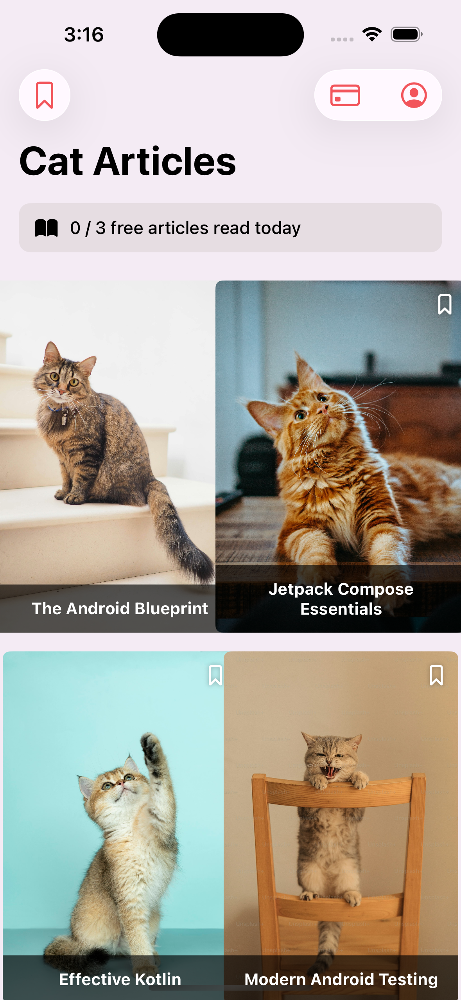
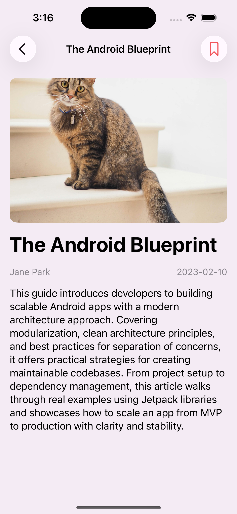
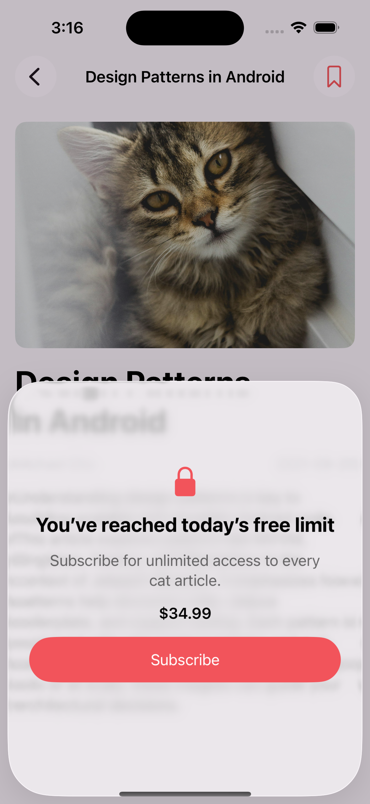
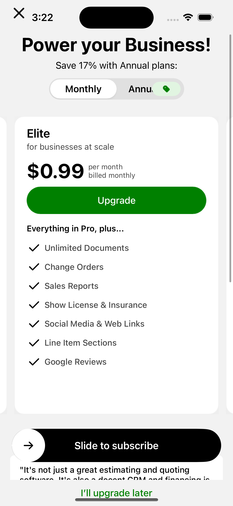
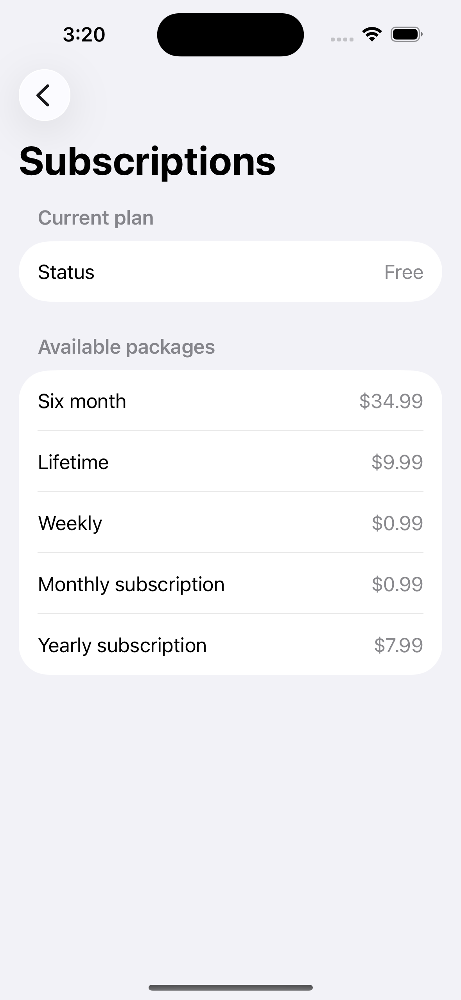
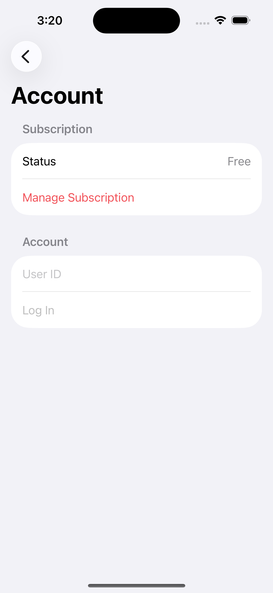
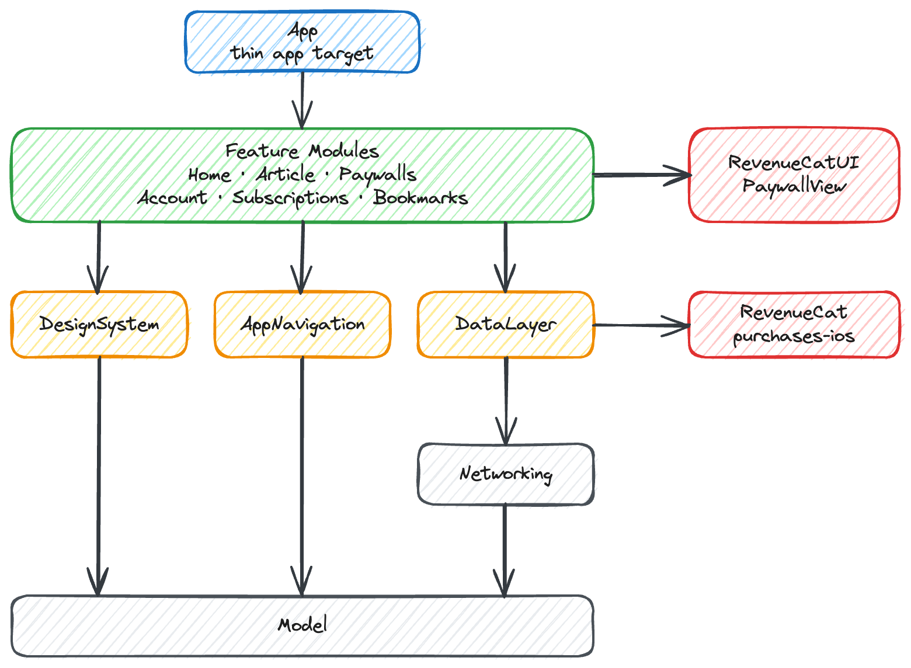

<h1 align="center">Cat Paywall SwiftUI</h1>

<p align="center">
  <a href="https://opensource.org/licenses/Apache-2.0"></a>
  
  
  <a href="https://github.com/RevenueCat/cat-paywall-swiftui/actions/workflows/build.yml"></a>
</p>

🐈 **Cat Paywall SwiftUI** is the native SwiftUI counterpart of [Cat Paywall Compose](https://github.com/RevenueCat/cat-paywall-compose) (Android) and [Cat Paywalls KMP](https://github.com/RevenueCat/cat-paywalls-kmp). It shows you how to build in-app subscriptions and a server-driven paywall for the App Store using [RevenueCat's iOS SDK (`purchases-ios`)](https://github.com/RevenueCat/purchases-ios) and SwiftUI.

It is a native port of the same **"Cat Articles"** demo: read cat articles, with **3 free articles per day** for non-subscribers and the `premium` entitlement unlocking unlimited reading and bookmarks.

The purpose of this repository is to demonstrate the following:

- In-app purchases (subscriptions) on the App Store via RevenueCat + StoreKit.
- A **server-driven paywall** built with RevenueCat's Paywall Editor (`PaywallView`), plus a custom **slide-to-unlock** purchase flow.
- Checking user **entitlements** and gating features accordingly.
- RevenueCat's **Customer Center** for subscription management.
- A clean, modular architecture using a Swift Package, `@Observable` MVVM, and `NavigationStack`.

## 📷 Previews

<p align="center">



</p>

<p align="center">



</p>

<a href="https://www.revenuecat.com/docs/getting-started/quickstart?utm_medium=organic&utm_source=github&utm_campaign=advocate">

</a>

## 🐈 RevenueCat In-App Purchase SDK

Cat Paywall SwiftUI is built using the [RevenueCat SDK for iOS](https://www.revenuecat.com/docs/getting-started/installation/ios?utm_medium=organic&utm_source=github&utm_campaign=advocate) to implement in-app subscriptions and a paywall system on top of StoreKit. [RevenueCat](https://www.revenuecat.com?utm_medium=organic&utm_source=github&utm_campaign=advocate) handles first-party purchases, manages customer data, supports A/B testing, and provides source-of-truth analytics across platforms.

## 💻 Codelab

This sample pairs with RevenueCat's iOS codelabs. Follow them to set up the dashboard and learn the SDK end to end:

1. [RevenueCat App Store Integration](https://revenuecat.github.io/codelabs/app-store/index.html): configure products on App Store Connect, connect them to the RevenueCat dashboard, understand **Product / Offering / Package / Entitlement**, and design a paywall with the [Paywall Editor](https://www.revenuecat.com/docs/tools/paywalls?utm_medium=organic&utm_source=github&utm_campaign=advocate).
2. [iOS In-App Purchases & Paywalls](https://revenuecat.github.io/codelabs/ios.html#0): integrate the iOS SDK, implement in-app purchases, distinguish paying vs. non-paying users, and build a server-driven paywall screen.

## 🛠 Tech Stack & Open Source Libraries

- Minimum **iOS 17**, 100% [SwiftUI](https://developer.apple.com/xcode/swiftui/) + Swift Concurrency (`async/await`) + [Observation](https://developer.apple.com/documentation/observation) (`@Observable`).
- [RevenueCat & RevenueCatUI](https://github.com/RevenueCat/purchases-ios) (`5.103.0`, via Swift Package Manager): in-app subscriptions, server-driven paywalls (`PaywallView`), and the Customer Center (`CustomerCenterView`).
- [Kingfisher](https://github.com/onevcat/Kingfisher): asynchronous image loading and caching for article covers.
- **Swift Package Manager**: a local `CatArticlesKit` package modularizes the app into `core` + `feature` targets (mirroring the Android/KMP module split).
- `NavigationStack` for type-safe navigation, `URLSession` + `Codable` for networking, and `UserDefaults` for the reading tracker and bookmarks.
- [XcodeGen](https://github.com/yonaskolb/XcodeGen) generates the Xcode project from a declarative `project.yml`.

## 🔨 How to Build This Project

1. Configure your RevenueCat dashboard and App Store products by following the [RevenueCat App Store Integration codelab](https://revenuecat.github.io/codelabs/app-store/index.html). Once configured, create an [Offering](https://www.revenuecat.com/docs/offerings/overview?utm_medium=organic&utm_source=github&utm_campaign=advocate) and a [Paywall](https://www.revenuecat.com/docs/tools/paywalls?utm_medium=organic&utm_source=github&utm_campaign=advocate) in the dashboard.

2. Generate the Xcode project with [XcodeGen](https://github.com/yonaskolb/XcodeGen):

   ```bash
   brew install xcodegen
   cd cat-paywall-swiftui
   xcodegen generate
   ```

3. In the **API Keys** tab of your RevenueCat dashboard, copy the **App Store** SDK key (it starts with `appl_`) and paste it into [`App/Configuration.swift`](App/Configuration.swift):

   ```swift
   static let revenueCatAPIKey = "appl_YOUR_REVENUECAT_API_KEY"
   ```

4. Change the bundle id in [`project.yml`](project.yml) (`PRODUCT_BUNDLE_IDENTIFIER`) to match the app you configured in your RevenueCat dashboard, then re-run `xcodegen generate`.

5. Open `CatArticles.xcodeproj` and run on a simulator or device.

   The unit tests live in the `CatArticlesKit` package: `cd CatArticlesKit && xcodebuild test -scheme CatArticlesKit -destination 'platform=iOS Simulator,name=iPhone 17'`.

> The article feed loads from a public gist, so the app runs without an API key; you'll just see "Free" status and no offering until a real key + a dashboard offering/paywall are configured. For the SDK details, see the [iOS Purchases & Paywalls codelab](https://revenuecat.github.io/codelabs/ios.html#0).

## 💎 Premium-only Articles

Some articles are reserved for subscribers. The flag comes from the article feed itself: the pinned gist revision marks three articles with `"premium": true`, and every other article omits the key, which decodes as `false` (see [`Article`](CatArticlesKit/Sources/Model/Article.swift)).

One pure function, [`ArticleAccess.evaluate`](CatArticlesKit/Sources/DataLayer/ArticleAccess.swift), decides what tapping an article does, in this order:

1. The `premium` entitlement is active: open the article.
2. The article is premium: show the premium paywall. The daily quota of 3 free articles never gates premium articles.
3. The daily free quota is spent: open the existing paywall screen.
4. Otherwise: open the article.

The home grid applies the full rule. Bookmarks only apply the premium part, so a lapsed subscriber tapping a bookmarked premium article gets the premium paywall, while bookmarks stay free of quota gating as before. Premium articles show a **Premium** pill, with a lock while the user is not subscribed.

The premium paywall is the reusable `premiumPaywall(for:onUnlock:)` modifier in [`FeaturePaywalls`](CatArticlesKit/Sources/FeaturePaywalls/PremiumPaywall.swift), used by both Home and Bookmarks. It fetches the current offering through `PaywallsRepository` and presents it with RevenueCatUI's `presentPaywall(offering:)`. When a purchase or restore activates `premium`, the tapped article opens once the paywall is dismissed; closing it without buying keeps the user where they were. The rule and the feed decoding are unit tested in `CatArticlesKit/Tests`, and CI runs those tests on an iOS Simulator.

## 🚪 Exit Offers

An exit offer is a second paywall that RevenueCat shows when a user closes your paywall without purchasing, for example with a discount or a free trial. The premium paywall is presented with `presentPaywall(offering:)`, the presentation API that supports exit offers (a `PaywallView` you place in your own sheet does not). The SDK shows the exit offer by itself, so the app needs no extra code; a purchase made from the exit offer unlocks the article just like one made from the main paywall. The custom slide-to-unlock paywall screen embeds `PaywallView` directly, so exit offers do not apply there.

To set one up in the RevenueCat dashboard:

1. Create a second Offering for the exit offer and [give it its own paywall](https://www.revenuecat.com/docs/tools/paywalls/creating-paywalls).
2. Open the main paywall (the one attached to your current Offering), go to its **Paywall settings**, and choose the new Offering as the **Exit offer**.

See [Displaying Paywalls](https://www.revenuecat.com/docs/tools/paywalls/displaying-paywalls) for which presentation APIs support exit offers.

## 🏛️ Architecture

All code lives in a local Swift package, `CatArticlesKit`, with a thin app target on top:

<p align="center">

</p>

Arrows point from a module to its dependencies. `Feature*` modules pull in **RevenueCatUI** for the Paywalls and Account screens (Home and Bookmarks reach it through `FeaturePaywalls`, which owns the premium paywall), while the core **RevenueCat** SDK stays isolated in `DataLayer`.

State flows down via `@Observable` stores injected through the SwiftUI environment; events flow up to the view models, the same **unidirectional data flow** as the Compose/KMP samples. All RevenueCat calls are isolated in `DataLayer` behind a `PaywallsRepository` protocol.

## 🤝 Contribution

Anyone can contribute and improve this project following the [Contributing Guideline](CONTRIBUTING.md).

## 📄 Image Credits

All cat images used in this demo project are copyrighted and belong to [Unsplash](https://unsplash.com/).

## Find this repository useful? 😻

Support it by joining __[stargazers](https://github.com/RevenueCat/cat-paywall-swiftui/stargazers)__ for this repository. :star: <br>
Also, __[follow the main contributor](https://github.com/skydoves)__ on GitHub for the next creations! 🤩

# License
```xml
Copyright (c) 2026 RevenueCat, Inc.

Licensed under the Apache License, Version 2.0 (the "License");
you may not use this file except in compliance with the License.
You may obtain a copy of the License at

   http://www.apache.org/licenses/LICENSE-2.0

Unless required by applicable law or agreed to in writing, software
distributed under the License is distributed on an "AS IS" BASIS,
WITHOUT WARRANTIES OR CONDITIONS OF ANY KIND, either express or implied.
See the License for the specific language governing permissions and
limitations under the License.
```
